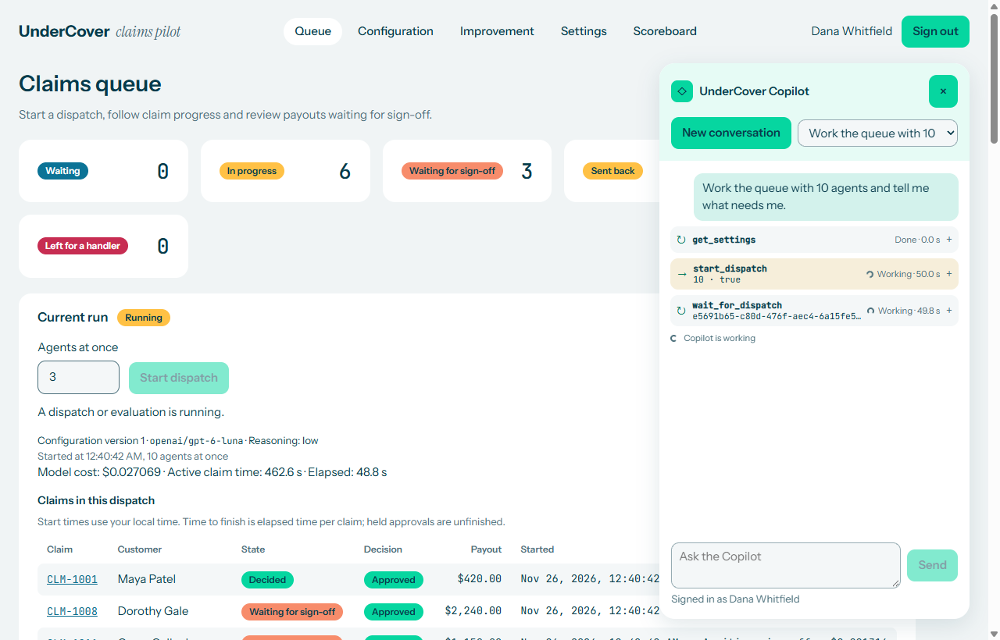

# UnderCover

**AI-assisted travel insurance claims operations**

UnderCover is a claims platform for a fictional travel insurer. Its agent reviews submissions, policy wording, and customer history to approve, decline, or refer claims. Handlers can inspect the evidence and payout calculation, send a decision back for review, or sign off on a simulated payment.

I'm **Joseph Gabriel Castro**. I extended Ed Donner's UnderCover course project so claims handlers could run the queue, review payouts, and measure whether a new agent configuration was worth keeping.

## My work

- **Recoverable queue processing.** I built a dispatcher that runs up to 25 claims in parallel. Each claim runs on its own LangGraph thread with PostgreSQL checkpoints, so a later dispatch can resume an interrupted attempt. The backend guards against duplicate decisions and payments. [Dispatcher](agent/dispatcher.py) · [Claim graph](agent/harness.py)
- **Evaluation and rollback.** I added a Scoreboard that compares agent decisions with handler labels on isolated claim copies, plus a versioned improvement workflow. In one recorded round, an approved candidate reached 84% payout accuracy on both held-out runs. The backend rolled it back when model cost exceeded the configured tolerance. [Scoring](backend/scoring.py) · [Run notes](docs/STATUS.md#improve-live-verification)
- **Handler Copilot.** I built a dashboard assistant that can investigate claims, start runs, and submit reviews under the signed-in handler's permissions. It keeps private conversation history and ties payout confirmation to the exact claim decision the senior handler saw. [Copilot graph](agent/copilot/graph.py) · [Backend records and safeguards](backend/copilot_records.py)

## What I verified

In the recorded local handover, a ten-agent dispatch completed all 26 queued claims. On a separate 25-claim held-out set, **80%** were handled straight through and **88%** had payouts within $1 of the reference. A senior handler confirmed one $3,750 simulated payout after reloading the dashboard. A non-senior handler's sign-off request was refused. [Handover record](docs/PLAN_COPILOT.md#local-handover-record)

## Run locally

The stack uses React and TypeScript, FastAPI, Supabase Auth and PostgreSQL, and LangGraph. The context service exposes policy and claims guidance over MCP. The repository includes packaging for AWS Lambda and Bedrock AgentCore. [Architecture and deployment](docs/TECH_STACK.md)

With uv and Node 24.15+ installed, run `uv sync` and `npm install` from the repository root. For the live workflow, configure `DATABASE_URL`, `VITE_SUPABASE_URL`, `VITE_SUPABASE_PUBLISHABLE_KEY`, `OPENROUTER_API_KEY`, and a random `UNDERCOVER_API_KEY` in `.env`. Create a Supabase Auth user whose email matches a [seeded handler](data/handlers.json).

Run `npm run seed` against a fresh development database, then `npm run dev`. Open the [dashboard](http://localhost:5173), sign in, and start a dispatch from the queue. To verify the project with service stand-ins, run `npm run check`. [Development notes](docs/STATUS.md#running-it)

Original course project by Ed Donner for *AI FDE: The Forward Deployed Engineer & Agentic AI Architect*. [Course repository](https://github.com/ed-donner/undercover)
